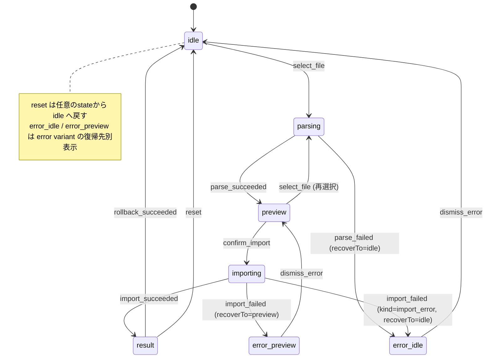

> **親文書**: [FUNCTION_DESIGN.md](../FUNCTION_DESIGN.md)
> **入力ドキュメント**: ARCHITECTURE.md（タスク仕様）、[ui-task-specs.md §UI-07](../architecture/ui-task-specs.md)（タスク要求）、[SCREEN_DESIGN.md §CSV取込み画面](../SCREEN_DESIGN.md)（レイアウト判断）、[32-biz-csv-import-service.md](32-biz-csv-import-service.md)（BIZ-03 型定義 + 業務ロジック SSOT）、[41-cmd-pos.md §17.5](41-cmd-pos.md)（CMD-07 シグネチャ + 入出力例）、[2026-05-13-phase-2-ui-07.md](../archive/plans/2026-05-13-phase-2-ui-07.md)（実装プラン、本書の判断根拠）

## 55. UI-07: 売上データ取込み画面

### 計数の置き場と在庫の求め直しの契約（proposed・未実装、D-118）

[棚卸しの数の置き場と在庫の求め直しの ADR](../adr/2026-10-16-stocktake-count-placement.md)（SPEC-STK-CNT-D3・D4・D7）の Z004 タブの側。今の file 選択 → preview → 結果を使い、新しい画面や在庫のスキップの checkbox は作らない。旧 ADR（時点証拠）の準備表示（`get_pos_stock_readiness`）・stock_review・共有 JAN の保留・相殺の確認待ち・同一性の拒否の欠落表示・非連動化の未調整・取消の保留の表示は持たない（置き換えた）。

| 状態 | 表示・操作 | 書込みと回復 |
|---|---|---|
| preview の拒否 | BIZ の message（精算回数の無い file、レジの番号が合わない、同じ精算の別の資料、レジの日付か番号が合わない。[32](32-biz-csv-import-service.md) の新契約の表）を Alert で出す | 取り込まない。「ファイルを選び直す」へ戻す。追加の確認で外さない |
| preview ready | 集計と、知らせ（「精算 n〜m が取り込まれていません」〈1 つなら「精算 n が取り込まれていません」〉、「レジと PC の日付がずれている可能性があります」） | 知らせは取込みを止めない。同じ精算日の別の精算でも追加の確認の step は出さない（Z004） |
| 取込みの結果 | 売上の件数と合計に加え、要再確認の一覧（この取込みで求め直した商品のうち要再確認の商品。「○○は数えた日に売り買い（入出庫）がありました。棚の数を確かめて入れ直してください」、商品・範囲・理由） | 取込みは完了している。一覧から [73](73-ui-stocktake.md) の「入れ直す」へ進む（「入れ直す」は fresh な計数で、取り込み済みの精算と保存の前に入れた入出庫を含む数になる。ADR D3） |
| 取消の結果 | 取消の完了と、要再確認になった商品の一覧 | 補償や保留の step は無い |

- 要再確認は日本語の label と icon を併用し、色だけで示さない。範囲は「4〜5」の形で、長さの商品は m の形（SPEC-UNIT-D3）。
- 取込みの確定と取消は停止 ADR の 5 つの入口と同じ runtime の配布の単位で新しい経路に繋ぐ（SPEC-STK-CNT-D12）。それまでは §55.0 の停止の案内のまま。

> **2026-08-01 evidence sync（2026-08-17 実態同期）**: UI-07 は「売上データ取込み」画面として、current operation の主動線を Z001/Z002/Z005 日報取込みに置く。既存の Z004 CSV import UI はPLU登録後の商品別売上・`pos_stock_sync`在庫増減・rollbackを実装済みの別トラックとして残し、IO-02は従来shapeと2026-07-06店舗採取layout Aを受理する。日報取込みは [37-biz-daily-report-import-service.md](37-biz-daily-report-import-service.md) / [45-cmd-daily-report-import.md](45-cmd-daily-report-import.md) を呼び、`sale_records` / `inventory_movements` を作らない。

### 55.0 REQ-401再設計ターゲット

#### 画面構成

| 取込みトラック | 既定 | CMD | 保存先 | 用途 |
|---|---|---|---|---|
| 日報取込み | 既定 | CMD-12 `scanRegisterSd` / `parseAndValidateDailyReportFromSd` / `parseAndValidateDailyReport` / `commitDailyReportImport` / `rollbackDailyReportImport` | `daily_report_imports`, `daily_report_*_lines` | 公式日報サマリ、支払集計、部門別売上 |
| 商品別CSV取込み（Z004） | PLU運用後の別トラック | CMD-07 `parseAndValidateCsv` / `commitCsvImport` / `rollbackCsvImport` | `csv_imports`, `csv_import_errors`, `sale_records`, `inventory_movements` | 商品別売上、`pos_stock_sync`在庫増減・rollbackは実装済み。IO-02は従来shape + 店舗採取layout Aを受理 |

#### 日報取込みの利用者フロー

1. 画面タイトルは「売上データ取込み」。既定タブは「日報取込み」。
2. 標準の手順はレジの SD を直接読む（D-111、UI-07-D12・D15・D16）。利用者はレジの精算の後に SD をこの PC に差し、「SD から読む」を押す（CMD-12 `scanRegisterSd`）。読み終えると「読み終わりました。いつもの取込みが済んでいれば、SD はレジに戻してください（次の精算に要ります）。」を出し、精算の一覧（UI-07-D15）を出す。利用者は「取り込めます」の行の「確認する」を押し（CMD-12 `parseAndValidateDailyReportFromSd`）、以下の手順 3 のプレビューへ進む。アプリの取込みは CV17 の取込みに依らない。ただし取込み済みを `XZ_BKUP` へ移すアプリの操作（D-111 (1) の (b)、後続の lane）ができるまで、店は CV17 の取込みを今の運用のまま続ける（D-111 の運用の制約）ので、画面・案内で CV17 の取込みを不要と言わない。(b) の後は CV17 の取込みは要らない（CV17 は PLU のレジへの書込みだけに使う）。layout A/B の互換対応は parser の責務で、採取元や layout を選ばせない。
   - 取り込むと、読んだ 3 本の写しをアプリが PC に残す（BIZ-08-D5。利用者の操作は無い）。写しを保存できなかったときは取込みが止まり、CMD-12 が kind `internal` と固定の文（45 §45.7 の `SourceCopyFailed` の行）を返す。UI は既存の `decideRecoverTo`（`src/features/daily-report-import/hooks/useDailyReportImportFlow.ts`、`import_error` 以外は `preview`）で `recoverTo: "preview"` にし、reducer の `import_failed`（`src/features/daily-report-import/reducer.ts` の `dailyReportImportReducer`）が preview・preview token・file 名を `previousState` に保ち、error の「戻る」（`dismiss_error`、同 `dailyReportImportReducer`）で同じ preview に戻る。利用者は空き容量を直してから同じ preview の「取り込む」を押し、同じ token で commit する（CMD の cache は 45 §45.4 手順 7 で残っている）。写しの失敗（kind `internal`）のために commit の失敗の分岐（`decideRecoverTo` の `import_error` → `idle`、それ以外 → `preview`）は変えない（写しの失敗を `import_error` にしないことで preview に戻す）。reducer に足す状態（`scanning`・`sd_list`、recoverTo `sd_list`）は UI-07-D15 (5) が決める（今の `DailyReportErrorRecoverTo` は `src/features/daily-report-import/types.ts` の `"idle" | "preview"` で、runtime の lane で `"sd_list"` を足す）。
   - SD が見つからない・2 枚以上・レジの SD でない・読めないときは、BIZ-08 §37.9 の固定の文を、「SD から読む」ボタンの直下に destructive 系テキスト + アイコンで出す（上部 Alert 帯は取込み済み / 同日追加確認などデータ安全系の状態専用のまま）。SD が見つからないときは同じ場所に「場所を選ぶ」（folder の選択の dialog、選んだ path を `scanRegisterSd` に渡す）を出す（UI-07-D15）。
   - 予備の経路「ファイルを選んで取り込む」（UI-07-D16）: native file dialog で Z001/Z002/Z005 を選び、CMD-12 `parseAndValidateDailyReport` を呼ぶ。SD が読めないとき・窓より前の過去の分・PC の `EcrDatas` の写しから取り込むときに使う（SD の上の file を選んでも、SD の入力として扱う。UI-07-D16）。ファイルは 1 つずつ選び足し・個別に外せる（UI-07-D16）。読み取り失敗、サイズ超過は toast に加え、ファイル選択ボタン直下に destructive 系テキスト + アイコンで1スロット表示する。
3. プレビューに対象日、3ファイル名、総売上/純売上、支払集計、部門別集計、部門未対応warningを表示する。
4. 同一bundle取込み済みはブロック。同じ精算を別のファイルから取込み済み（BIZ-08-D4）と、SD の束で精算回数を確かめられないもの（BIZ-08-D6。一覧では「読めません」で、通常はここまで来ない）もブロックし、BIZ の固定の文を出す。同一日別bundleは既存分を残す追加確認を出す。
5. 第2スライスでは取込み結果に「日次売上を見る」CTAを表示し、`/reports/daily?date={reportDate}`（取込み対象日）へ遷移する。日次/月次売上画面では日報集計を公式表示し、商品別明細とは混ぜない。
6. 取消は日報取込みの論理rollbackであり、在庫数は変わらないことを結果画面に明示する。

#### 既存Z004 UIの扱い

- 既存 `CsvImportPage` / `useCsvImportFlow` / reducer はZ004商品別CSV取込みトラックとして維持できる。
- 画面文言「Z004形式の売上CSV」は既定主動線から外し、「商品別CSV取込み（Z004）」などPLU後の用途が分かる名称へ変更する。
- Z004トラックは、PLU登録後にZ004が商品別売上として取得できることを実機確認してから運用主導線に出す。

#### 現行buildの一時停止

現行 build では、Z004 タブの取込みの確定と取消は一時停止中である（[停止 ADR](../adr/2026-09-23-legacy-stocktake-z004-write-stop.md) SPEC-STOP-D4。backend の停止は [32 §15.0](32-biz-csv-import-service.md#150-現行buildの一時停止)）。停止状態は `components/PreviewStep.tsx` が定義・export する定数 1 つが所有し、`PreviewStep` はそれを既定値にする prop `importSuspended` で受ける。`CsvImportPage.tsx` は同じ定数を import し、停止中は Z004 タブ（`CsvImportFlowPanel`）の先頭に warning の Alert（`AlertTriangle` icon + 見出し + 本文）を出す。既存の flow test は停止 off を渡して維持する。

| 場所 | 文言 |
|---|---|
| 停止の案内 見出し | 商品別CSV（Z004）の取込みは一時停止中です |
| 停止の案内 本文 | 取込みや取消で在庫が二重に減ったり戻ったりする不具合を直しています。直るまで、取込みの確定と取消はできません。ファイルの内容確認（プレビュー）と日報の取込みはできます。 |

- 無効にする操作: プレビューの「取り込む」（押しても `onConfirm` を呼ばない）。取消の画面入口は結果 step だけで、commit の停止により到達しない（backend も停止）。
- 使える操作: ファイル選択、プレビュー（正常行・スキップ行・警告・同日追加の表示）、「ファイルを選び直す」、日報取込みタブの全操作。
- UI の定数は安全の根拠にしない。古い画面や直接の command 呼出しでも backend が停止 error（kind `import_error`）を返し、既存の `ErrorState` に文言が出る（recoverTo = idle）。
- 停止の解除は ⑤ だけで行う（SPEC-STOP-D6）。

#### UI判断 ID

- `UI-07-D9`: 日報取込みとZ004商品別取込みを同一テーブル/同一結果として表示しない。理由は、Z001/Z002/Z005は集計日報であり商品別明細や在庫引落しを復元できないため。
- `UI-07-D10`: 日報取込みでは部門未対応をwarningとして表示し、取込み自体は可能にする。理由は、日報の正本性を優先し、部門マスタ修正を後続作業にできるようにするため。
- `UI-07-D11`: Z004取込みはPLU運用後の商品別・在庫連動トラックとして分ける。理由は、レジ変更時に日報主入力と商品別在庫連動のadapter差し替え点を分離するため。
- `UI-07-D12`（2026-10-06 改訂、D-111）: 日報取込みの標準入力元はレジの SD の原本で、アプリが直接読む。アプリは CV17 の取込みを前提にしない（`XZ` と `XZ_BKUP` の両方を読む）。CV17 を PLU の書込みだけに使うのは取込み済みを `XZ_BKUP` へ移すアプリの操作（D-111 (1) の (b)、後続の lane）の後で、それまでは店が CV17 の取込みを今の運用のまま続ける（D-111 の運用の制約）。画面・案内で CV17 の取込みを不要と言わない。layout A/B対応はparserの互換性であり、operator向けに複数の通常手順を提示しない。旧版（2026-08-01）の「CV17取込み後のPC側`EcrDatas`に固定」は置き換えた。手でファイルを選ぶ経路は予備（UI-07-D16）。
- `UI-07-D15`（D-111）: SD の読取りの画面。(1) 「SD から読む」は日報取込みタブの最初の主操作。自動で探して見つからなければ「場所を選ぶ」を出す（owner 決定 2026-10-06: 自動で探し、見つからなければ利用者が選ぶ）。(2) 読み終えたら、一覧より上に「読み終わりました。いつもの取込みが済んでいれば、SD はレジに戻してください（次の精算に要ります）。」を出す（読んだ内容はアプリが 30 分持ち、その後は読み直しが要る）。取込み済みを `XZ_BKUP` へ移すアプリの操作（D-111 (1) の (b)）ができるまで店は CV17 の取込みを今の順（CV17 の取込み → 「SD から読む」）で続ける（D-111 の運用の制約）ので、CV17 の取込みと矛盾しない文にする。読み終えた直後に無条件で「SD をレジに戻して」と言うと、CV17 の取込みの前に SD を戻させてしまう。(b) の後は「いつもの取込みが済んでいれば、」を外す（UI-07-D15 の見直しの契機）。(3) 一覧の行は精算ごとで、日付（中身の日付、無ければ folder の日付）・3 ファイル名・状態を出す。状態は色だけで示さず、日本語の label と icon を併用する: 「取り込めます」（行に「確認する」）、「取込み済み」、「同じ精算を取込み済み」、「ファイルがそろっていません」、「読めません」。一覧の上の文は候補の状態の数だけで決める（`DailyReportSdCandidateStatus`、37 §37.9）: (a) `NotImported` が 1 件以上なら文を出さない（行の「確認する」から選ぶ）。(b) `NotImported` が 0 件で、`Incomplete` か `Unreadable` が 1 件以上なら「取り込める精算はありません。取り込めない精算が N 件あります（「ファイルがそろっていません」「読めません」の行）。」（N は `Incomplete` と `Unreadable` の数の和）。(c) 候補が 0 件、または全件が `Imported` か `SameSettlementImported` なら「新しい精算はありません」。(b) のときに「新しい精算はありません」を出さない（取り込めない精算を「無い」と読ませない）。読まなかった名前の file があれば件数だけを「読まなかったファイル N 件」と補足する。(4) プレビューの「ファイルを選び直す」は SD から来たときは一覧（`sd_list`）へ戻る。scan_token が切れているかを UI は確かめない（UI は 30 分の期限を持たない。期限は CMD-12 の scan cache だけが持つ、45 §45.6b 手順 2）。一覧の上には常に「SD から読む」（読み直し）を出し、期限の切れた一覧で「確認する」を押すと (5) の SD から来た parse の失敗になる。(5) 状態の追加: reducer に `scanning`（読取り中、ボタン disabled）と `sd_list`（scan と scan_token を持つ）を足し、`sd_list` → 「確認する」→ 既存の `parsing` → `preview` へ進む。SD から来た parse の失敗は、CMD-12 `parseAndValidateDailyReportFromSd` の error の kind と message に依らず、すべて `error`（recoverTo `sd_list`、previousState に一覧）にする（scan_token の期限切れ〈45 §45.6b 手順 2、`import_error`・固定の文「SD を読んでから時間がたちました。もう一度 SD を読んでください。」〉、取り込めない候補〈同 手順 3、`validation`〉、BIZ-08 の parse の失敗を含む。message の文字列で分岐しない）。「戻る」で一覧に戻り、期限切れなら固定の文のとおり一覧の上の「SD から読む」で読み直す。importing 中の離脱防止（`useBlocker`）は今どおり。scanning 中は離脱しても副作用が無いので block しない。
- `UI-07-D16`（D-111）: 予備の経路「ファイルを選んで取り込む」。1 ファイルずつ選び足せ、選んだものを個別に外せる（owner 要望 2026-10-06）。選んだファイルは「Z001・Z002・Z005 のどれか」を名前で仮に示し、3 つそろうまで「確認する」を押せない（同じ系列を 2 つ選んだら後から選んだ方を置き換えるか確かめる）。系列の最終判定は IO-07（名前と中身）で、UI の仮の表示を根拠にしない。置き場所は日報取込みタブの中の小さな補助のリンク「ファイルを選んで取り込む」（owner 決定 2026-10-06、D-111。ひとまずの置き場所で、画面のデザインを刷新するときに見直す）。選んだ file は native file dialog の path から読み、その path を CMD-12 §45.3 の `source_path` に入れて渡す（今の `useDailyReportImportFlow.ts` は path を `extractFilename` で捨てて `{ filename, file_bytes }` だけを送るので、runtime の lane で `source_path` を足す）。path を持たない入力（drag & drop の `File` 等）はこの経路で受けない（SD 上の file かを確かめられないため。今の日報取込みタブは dialog だけを使う〈`DailyReportImportPage.tsx` の `onChooseFiles`〉）。選んだ file が自動で見つけたレジの SD の上にあれば、BIZ-08 がその file を SD の入力として扱い（37 §37.3 手順 1a）、写しを残し（BIZ-08-D5）、精算回数の無い束を止める（BIZ-08-D6）。SD の上の file を選んだ後、preview の前に SD を抜くと、その file が見つからないので BIZ の固定の文（37 §37.7 の「preview の時に見つからない」の行）で止まり、PC 上の file としては通らない（表示は既存の preview の失敗〈`import_error`〉と同じ）。PC 上の file（`EcrDatas` の写し等）は今どおりで、写しを作らない。前回選択フォルダの記憶（`inventory:daily-report-import:last-dir:v1`）はこの経路だけに使う。選択の一覧の細部（2026-10-17、SD 直読みの runtime の起票で埋めた）: (a) 「ファイルを選んで取り込む」で native file dialog（複数を選べる）を開き、選んだ file を一覧に足す。一覧は `idle` の間だけ hook が持ち、reducer の状態は増やさない（プレビューへ進む〈`parsing`〉か画面を離れると空になる）。(b) 一覧の行は、仮の系列（名前に `Z001`・`Z002`・`Z005` のどれを含むか。大文字小文字を区別しない。IO-07 の source の判定と同じ手がかり）・file 名・「外す」ボタン。(c) 名前から系列を決められない file は足さず、選択のボタンの直下（既存の 1 スロットの表示）に「Z001・Z002・Z005 のどれかの名前のファイルを選んでください。」を出す。1 回の dialog で同じ系列を 2 つ以上選んだときは、その回の file をどれも足さず、同じ場所に「Z001・Z002・Z005 は 1 つずつ選んでください（同じ種類のファイルが 2 つ以上あります）。」を出す。(d) 一覧にすでにある系列の file を選ぶと、確認の dialog（`src/components/ui/alert-dialog.tsx`）を出す: title「{系列} のファイルを置き換えますか？」、description「選んであった {前の file 名} を外して、{新しい file 名} を使います。」、actions「キャンセル」/「置き換える」。キャンセルでは一覧を変えない。(e) 3 系列がそろうと「確認する」を押せ、押すと 3 つの path・bytes で §45.3 を呼ぶ（既存の `parsing` へ）。(f) 読めない file と 20MB を超える file は足さず、既存の文（「日報ファイルの選択または読み取りに失敗しました」「ファイルサイズが上限(20MB)を超えています」）を同じ場所に出す。今の hook の `selectFiles`（`File` を受ける。path を持たないので本経路の契約に合わず、画面からは呼ばれていない）は外す。
- `UI-07-D17`（D-121、proposed・未実装。runtime は backlog の「SD の一括取込みと EJ の控えの runtime（A）」、Z004 の行は「Z004 を SD の一括取込みに入れる runtime（B）」）: 締めの一括取込み。UI-07-D15 の一覧の上に主操作「まとめて取り込む」を置き、押すと CMD-12 `commitRegisterSdBulkImport`（45 §45.6c）で日報 → Z004 → EJ の順に取り込む（BIZ-08-D7）。押せるのは、日報の `NotImported` が 1 件以上、`DailyReportSdScan.ej` の `new_count`・`held_count`・`conflict_count`・`unreadable_file_count` のどれかが 1 以上（新しい控えが 0 件でも、保留・食い違い・読めない file の番号・file 名・直し方は結果でしか名指しできないので、同じボタンから結果へ進める。EJ は数えるだけで何も入らないことがある）、または (B) の後は `z004_new_count` か `z004_unreadable_count` が 1 以上のときだけで（`z004_new_count` は hash だけで数えるので、押しても Z004 が全部「取り込みませんでした」になることがある。読めなかった Z004 は EJ の読めない file と同じく、押した結果で file 名と直し方を名指しする）、無ければ押せず UI-07-D15 (3) の文のまま。一覧の下に「レシートの控え（EJ）: 新しい控え N 件」を出す（0 件は「新しい控えはありません」。`DailyReportSdScan.ej` が None〈SD に EJ の file が無い。一括取込みの結果にも EJ の項目ができない、37 §37.10 手順 1 (c)〉なら、この行を出さない。読めない file・同じ番号で中身の違う記録があれば「読めない EJ のファイルが N 本あります」「同じ番号で中身の違う控えが N 件あり、取り込みません」を添え、保留があれば下の結果の保留の文を同じ出し方で添える）。(B) の後は `z004_unreadable_count` が 1 以上なら、一覧の下に「読めない商品別の売上（Z004）のファイルが N 本あります」を出す（0 は出さない）。既存の行の「確認する」（1 件ずつの preview）は残す。取込み中は `importing` と同じく離脱を block し、ボタンを disabled にする。結果は項目ごとに 1 行で、日本語の label と icon を併用し色だけで示さない。(B) の Z004 の行は精算日（`RegisterSdBulkSource::Z004` の `settlement_date`。None の項目は file 名〈`sd_relative_path` の最後の要素〉）で名指しする: 「取り込みました」（日報は対象日・総売上・純売上、(B) の Z004 は精算日・件数・合計と 32 の新契約の知らせ。Z004 の `ImportResult.status` が `completed_partial`〈取り込まなかった行がある〉なら label を「一部を取り込みました」にし、「取り込まなかった行が N 件あります」〈N は `skipped_count`〉と、その取込みの詳細〈`/csv-import/records/$importId`、`$importId` は `csv_import_id`。[65](65-inventory-record-traceability.md) §65.3 の CSV 取込み詳細で、取り込まなかった行〈エラー行〉を出す既存の画面〉へのリンク「取り込まなかった行を見る」を添える。件数と合計だけで「取り込みました」と出すと入らなかった行が黙って消え、読み直しでは同じ hash で取込み済みになって二度と出ない）、「取り込みませんでした」（BIZ の文。scan で読めなかった Z004 は file 名と、37 §37.10 手順 3 の文〈EJ の読めない file と同じ直し方〉）、「1 件ずつ確かめてください」（同日追加の確認が要る束。行の「確認する」へ）、「ここで止まりました」（wire の `Failed { kind, message }` の message。CMD が 45 §45.7 で変えた文）、「取り込んでいません」（止まった後）。止まったときは結果の上に「途中で止まりました。取り込めた分は残っています。原因を直してから、もう一度「まとめて取り込む」を押してください。」を出す。EJ は 1 行の項目で、結果は「控え N 件を取り込みました」（0 件は「新しい控えはありませんでした」）と、黙って過ぎないように次をその場で名指しする（owner の設計の原則、repo 外の回答台帳 TD-310）: 欠けがあれば「記録 n〜m の控えがありません」（区間ごと、6 桁の番号）と、その場の操作「EJ のファイルを選んで取り込む」（UI-09c-D5 と同じ CMD-12 `importEjFiles`）。保留（`held_count` が 1 以上）があれば「最後の控え N 件は、レジがまだ書き足すファイルの最後のため、今回は入れていません。次に SD を読んだときにもう一度確かめます（店の操作は要りません）」（SD から読んだ file も手で選んだ file も同じ文。いつもう一度確かめるかは 37 §37.11 手順 3 (d)、伸びうるかの判定は出所に依らない）。保留の文は、欠け・読めない file・conflict（放っておくと控えが欠けたままになる知らせ）と分け、注意の色と icon を付けない補足の文として EJ の行の中に出す（`XZ` 直下の EJ には毎日最後の記録があり、締めのたびに 1 件が保留になるので、毎日の注意書きにしない）。毎日出すかは (A) の Windows L3 で確かめ、雑音なら (A) の中で、保留の文を出さず、保留だけではボタンを押せる条件にも入れない形に直す（件数は結果の型に残る）。読めない file（`unreadable_files`。scan で読めなかった file を含む）があれば file 名と「SD を差し直してもう一度読むか、「EJ のファイルを選んで取り込む」で PC の写しを選んでください」。conflict があれば `conflicts` の番号（先頭 100 件。`conflict_count` が 100 を超えたら「ほか N 件」）を `saved` で分けて出す: `saved` が true の番号は「前に取り込んだ控えと食い違う控えがあったため、前の控えを残しました。前の控えは「レシートの控え」で見られます」（番号ごとに控えの画面へのリンク）、false の番号は「同じ番号の控えが食い違っていたため、保存していません」（リンクを出さない。開いても控えは無い）。どちらにも「続くときは開発者に知らせてください」を添える（店が直す操作は無い）。件数が 0 の項目（保留・読めない file・conflict・欠け）は行を出さない。(B) の後は要再確認の一覧を §55 冒頭の Z004 の表と同じ形で出す。結果の下に「日次売上を見る」と「レシートの控えを見る」（UI-09c）。読み終わりの案内（UI-07-D15 (2)、CV17 の取込みと矛盾しない文）は変えない。

### 本書のテンプレ判定（業務ロジックあり版、共通 6 項目）

UI 層関数設計書の 2 段階テンプレ（業務ロジック有無で使い分け、`memory/frontend-function-design-granularity.md`）に従い、UI-07 は**業務ロジックあり版**と判定する。

**判定根拠**:

- CMD 呼び出し: `commands.parseAndValidateCsv` / `commands.commitCsvImport` / `commands.rollbackCsvImport` / `commands.listCsvImports` の 4 件（3 useMutation + 1 useQuery）
- 入力バリデーション: ファイル拡張子 `.csv` / `.txt` + 上限 `CSV_IMPORT_FILE_SIZE_LIMIT`（bindings 生成定数、constants.rs SSOT。D-054）の事前防御（BIZ-03 / CMD-07 でも検証されるが、UI 側でも誤選択を弾く）
- 画面内部 state 駆動のフロー分岐: あり（6 variant discriminated union `CsvImportState` × 9 action の reducer、`DuplicateStatus` による同日追加確認分岐、`useBlocker` の importing 中常時 block）

→ **業務ロジックあり版**（複数 CMD + reducer 駆動分岐 + 排他制御）。共通 6 項目（モジュール構成 / React State / CMD 呼び出し / 利用者操作フロー / エラー表示 / ローディング表示）+ ショートカット・lifecycle / 状態遷移図 / エラーハンドリング備考 / テスト方針の 10 章構成。

| 種別 | 該当 UI |
|---|---|
| 業務ロジックあり版 | UI-00 / UI-shortcuts / UI-07（本書）/ UI-01a/b/c / UI-02〜10 / UI-13 |
| 業務ロジックなし版 | UI-12（[52-ui-shared-layout.md](52-ui-shared-layout.md)） |

UI-00 ([53-ui-home.md](53-ui-home.md)) が「4 useQuery 並列 + 部分障害許容」の初適用例、UI-shortcuts ([54-ui-shortcuts.md](54-ui-shortcuts.md)) が「CMD 呼び出し 0 件 + state 駆動分岐」の初適用例だったのに対し、本書は「3 useMutation + reducer 駆動フロー + commit/rollback の冪等性配慮 + `useBlocker` 排他制御」の初適用例。§55.2 で reducer の遷移表を確定し、§55.8 状態遷移図でその裏側を補完する。

---

### 55.1 モジュール構成

| ファイル | 責務 |
|---|---|
| `src/routes/csv-import.tsx` | TanStack Router file route。`<CsvImportPage />` mount のみに痩せる |
| `src/features/csv-import/CsvImportPage.tsx` | 最上位レイアウト。ページタイトル「売上データ取込み」とタブ（既定 `日報取込み` / `商品別CSV取込み（Z004）`）を所有する。Z004タブでは既存 `CsvImportFlowPanel` を表示する |
| `src/features/daily-report-import/DailyReportImportPage.tsx` | 日報取込みタブ。SD から読む一覧（UI-07-D15、未実装）と予備のファイル選択（UI-07-D16）、native dialog による Z001/Z002/Z005 3ファイル選択、プレビュー、同日追加確認、取込み結果、論理取消を描画する |
| `src/features/daily-report-import/types.ts` | `DailyReportImportState`（discriminated union。状態の一覧は UI-07-D15 (5) に従い、runtime の lane で `scanning`・`sd_list` と recoverTo の `"sd_list"` を足す）+ `DailyReportImportAction` 等の日報画面ローカル型 |
| `src/features/daily-report-import/reducer.ts` | 日報取込み state 遷移の純関数。preview snapshot を importing/error 復帰に保持する |
| `src/features/daily-report-import/hooks/useDailyReportImportFlow.ts` | `useReducer + useMutation × 3 + useBlocker` を束ねる日報取込み hook。日報ファイル選択は `@tauri-apps/plugin-dialog.open` + `@tauri-apps/plugin-fs.readFile` で行い、CMD-12 を呼ぶ（D-111 の runtime で、dialog の path を各要素の `source_path` に入れて送る。UI-07-D16）。ファイル選択ダイアログは前回選択フォルダ（localStorage key `inventory:daily-report-import:last-dir:v1`、選択パスから導出し件数チェック前に保存）を `defaultPath` に渡して開く。localStorage 不可の環境では記憶のみ無効化し選択フローは継続する（issue #135 派生。CASIO PCツール保存領域の深い年/月ディレクトリを毎回辿る operator 負担の除去）。commit/rollback 成功時は D-052-C10 の SSOT helper を適用する |
| `src/features/daily-report-import/reducer.test.ts` | REQ-401 日報取込み UI state の focused unit tests |
| `src/features/csv-import/CsvImportPage.tsx` 内 `CsvImportFlowPanel` | 既存Z004取込みフローの本体。`useCsvImportFlow()` の戻り値を子コンポーネントに分配し、`state.status` で 4 step UI を切替（`ParseStep` / `PreviewStep` / `ImportingStep` / `ResultStep`）+ `error` variant 重ね描き |
| `src/features/csv-import/types.ts` | `CsvImportState`（6 variant discriminated union）+ `CsvImportAction`（9 variant）+ `ErrorRecoverTo` 等の画面ローカル型 |
| `src/features/csv-import/reducer.ts` | `csvImportReducer(state, action): CsvImportState` 純関数。9 action × 6 state の遷移表を 1 箇所に集約。テスト容易性のため副作用ゼロ |
| `src/features/csv-import/hooks/useCsvImportFlow.ts` | `useReducer + useMutation × 3 + useBlocker` を束ねる中核 hook。dispatch + 副作用 trigger 関数（`selectFile` / `confirmImport` / `rollback` / `reset`）を露出 |
| `src/lib/extractFilename.ts` | 共通 FilePicker の dialog path / drop `File.name` から basename を取り出す純関数。`/` と `\` の両区切りに対応し、Windows WebView2 の絶対パス流入を両経路で防ぐ |
| `src/features/csv-import/lib/formatErrorRow.ts` | `ErrorRow.error_type` 4 値（`unmatched_product` / `invalid_format` / `invalid_jan` / `invalid_number`）→ Badge variant + ラベル変換純関数 |
| `src/features/csv-import/components/ParseStep.tsx` | step 1/3。`FileDropzone` + `Loader2` spinner（parsing 中）+ 状態文言 |
| `src/features/csv-import/components/PreviewStep.tsx` | step 2/3。`FileInfo` / `MatchedSummary` / `ErrorSummary` / `DuplicateCheck` の表示 + 「取り込む」「ファイルを選び直す」CTA |
| `src/features/csv-import/components/ImportingStep.tsx` | step 3/3（commit 進行中）。`Loader2 + animate-spin` + 「取込み中…数百行で約 N 秒かかります」補助文言 + 離脱不可バナー |
| `src/features/csv-import/components/ResultStep.tsx` | 完了表示。4 サマリ（csv_import_id / total_items / total_amount / skipped_count）+ 「売上レポートを見る」（UI-09a 着手済、`navigate({ to: "/reports/daily", search: { date: settlementDate } })` 遷移、Round 1 P1 fix で settlementDate URL state 化）+ 「取り消す」（rollback）+ 「ホームに戻る」 |
| `src/features/csv-import/components/ErrorState.tsx` | error variant の表示。CmdError kind 別メッセージ + 「最初に戻る」or「プレビューに戻る」ボタン（`recoverTo` で分岐）|
| `src/features/csv-import/components/AdditionalImportConfirmDialog.tsx` | 両タブ共通。`AdditionalImportConfirmationRequired` 時にactive同日import全件と今回分を示す shadcn `<AlertDialog>`。Esc はcancel（Radix標準）|
| `src/features/csv-import/components/ErrorRowsTable.tsx` | `ErrorSummary.items`（最大 100 件）の表示。`formatErrorRow` の Badge variant で色分け + `normalized_jan === null` で「(不明)」表示 |
| `src/features/csv-import/components/FileDropzone.tsx` | 共通 `FilePicker`（`accept=".csv,.txt"`）を用い、native dialog と drag & drop の両経路を同じ `{ bytes, filename, size }` 契約へ統合する |
| `src/features/csv-import/components/StepIndicator.tsx` | "1/3 ファイル選択" / "2/3 プレビュー" / "3/3 結果" のステップ表示 |

**接続点**:

- `src/routes/csv-import.tsx` が `<CsvImportPage />` を mount。TanStack Router の file-based routing で `/csv-import` パスに自動マップ
- `src/config/navigation.ts` の `ui-07` entry は `to: "/csv-import"` + `status: "active"` のまま、label/title を「売上データ取込み」にする
- `src/lib/query-keys.ts` に prefix helper `csvImportLists` と `dailyReportImportLists` を置く（§55.3 参照）
- `src/lib/bindings.ts` は commit 2 で `parse_and_validate_csv` / `commit_csv_import` / `rollback_csv_import` を specta 経由で自動再生成（`list_csv_imports` は UI-00 commit `2c1ac37` で済）
- CMD-12 実装PRでは `parse_and_validate_daily_report` / `commit_daily_report_import` / `rollback_daily_report_import` / `list_daily_report_imports` も specta 経由で自動再生成する

---

### 55.2 React State

UI-07 は `useReducer + discriminated union` の自力 state 機械（D-1: `feedback-recommend-with-explicit-basis.md` 適用 + Zustand 未導入 verify 済、状態数 6 の直線フロー、並行 / cancel / resume なし）+ 3 useMutation で構成。グローバル state は使わない（UI_TECH_STACK §2.6 維持）。

#### `CsvImportState` 6 variant 定義

```ts
export type CsvImportState =
  | { status: "idle" }
  | { status: "parsing"; filename: string }
  | { status: "preview"; preview: PreviewData; previewToken: string; filename: string }
  | { status: "importing"; preview: PreviewData; previewToken: string; additionalImportConfirmed: boolean; filename: string }
  | { status: "result"; result: ImportResult; settlementDate: string }
  | { status: "error"; error: InvokeError; recoverTo: "idle" | "preview"; previousState: CsvImportState };
```

- `previousState` 保持の根拠: error から preview に戻る経路で `preview` / `previewToken` / `filename` を捨てたくない。`recoverTo === "preview"` の時は reducer が `import_failed` 処理内で **preview variant を再構築して** `previousState` に詰める（importing variant をそのまま保存すると `dismiss_error` 側の型 narrow (`previousState.status === "preview"`) で受理できず idle にフォールバックしてしまう、PR #62 Codex Round 1 P2-1 起因の修正）
- `preview` (PreviewData) を `preview` / `importing` の 2 箇所に持つ根拠: `confirm_import` で `preview → importing` 遷移時に PreviewData を捨ててしまうと、`import_failed(recoverTo: "preview")` 時に preview variant を再構築できない。`importing` 中も snapshot として保持し、復帰経路の型安全を担保する
- `previewToken` を `preview` / `importing` の 2 箇所に持つ根拠: BIZ-03 の preview キャッシュは preview_token をキーに 30 分有効。`importing` 中も保持して rollback / 失敗時の再 commit を支える

#### `CsvImportAction` 9 variant 定義

```ts
export type CsvImportAction =
  | { type: "select_file"; filename: string }
  | { type: "parse_succeeded"; preview: PreviewData; previewToken: string }
  | { type: "parse_failed"; error: InvokeError }
  | { type: "confirm_import"; additionalImportConfirmed: boolean }
  | { type: "import_succeeded"; result: ImportResult; settlementDate: string }
  | { type: "import_failed"; error: InvokeError; recoverTo: "idle" | "preview" }
  | { type: "dismiss_error" }
  | { type: "rollback_succeeded" }
  | { type: "reset" };
```

`rollback_failed` は別 action にせず、rollback の useMutation `onError` で Sonner トースト + `state` 据え置きとする（rollback 失敗時に state を壊さない設計、`commands.listCsvImports` を再 fetch して result 表示は維持）。

#### reducer 遷移表（純関数 `csvImportReducer`）

| 現 state | action | 遷移先 | 備考 |
|---|---|---|---|
| `idle` | `select_file` | `parsing` | `parseAndValidateMutation.mutate(...)` 副作用は hook 側 |
| `parsing` | `parse_succeeded` | `preview` | preview + previewToken + filename を持ち越す |
| `parsing` | `parse_failed` | `error (recoverTo: "idle")` | filename 等は破棄、idle に戻す |
| `preview` | `confirm_import` | `importing` | additionalImportConfirmed = `DuplicateStatus === "AdditionalImportConfirmationRequired"` 時のみ true。preview / previewToken / filename を `importing` state に snapshot として持ち越す（`import_failed(recoverTo: "preview")` 時の復帰経路で preview variant 再構築に必要） |
| `preview` | `select_file` | `parsing` | 「ファイルを選び直す」CTA からの再 parse |
| `importing` | `import_succeeded` | `result` | settlementDate は preview.fileInfo から hook 側で抽出して action に詰める |
| `importing` | `import_failed` | `error (recoverTo: action.recoverTo)` | キャッシュ期限切れ等で「最初に戻る」分岐は kind 判定で hook 側が決定。reducer は `recoverTo === "preview"` の時 importing の preview snapshot から preview variant を再構築して `previousState` に詰める。それ以外は `state` (importing variant) を `previousState` にそのまま入れる |
| `result` | `rollback_succeeded` | `idle` | result 表示を破棄して初期化 |
| `result` | `reset` | `idle` | 「ホームに戻る」CTA からの明示 reset |
| `error` | `dismiss_error` | `previousState` (recoverTo: "preview") or `idle` | previousState を復元 / idle に戻す |
| 任意 state | `reset` | `idle` | 例外フロー（navigation 抜け道）用、commit 5 で 1 箇所のみ呼ぶ |

invalid 遷移（例: `idle` で `parse_succeeded`）は reducer 内で現 state をそのまま返す（state-machine 厳格化は Phase 1 7-7 Vitest 着手後に network test で違反検知できるようになるまで猶予）。

#### 3 useMutation のデータ

| useMutation | 入力 | 出力 |
|---|---|---|
| `parseAndValidateMutation` | `{ fileBytes: number[]; filename: string }` | `{ previewData: PreviewData; previewToken: string }` |
| `commitMutation` | `{ previewToken: string; additionalImportConfirmed: boolean }` | `ImportResult` |
| `rollbackMutation` | `{ csvImportId: number }` | `RollbackResult` |

`commands.*` 経由は specta 自動 camelCase 化（CMD 引数: `file_bytes` → `fileBytes`、`additional_import_confirmed` → `additionalImportConfirmed`、`csv_import_id` → `csvImportId`）。struct field は snake_case 直接アクセス（`previewData.file_info.settlement_date` 等、[53-ui-home.md §53.2 bindings.ts subsection](53-ui-home.md) と同方針）。

#### File → Vec<u8> 変換

共通 FilePicker（D-054）から得た `bytes` を `number[]` 化（specta 経由で Rust `Vec<u8>` に直マップ）。上限は CMD-07 で再検証されるが、UI 側でも `size > CSV_IMPORT_FILE_SIZE_LIMIT`（bindings 生成定数）で早期 reject + Sonner トースト（CMD-07 経由のラウンドトリップを避ける）。

#### 派生値

| 派生値 | 計算 | 計算箇所 |
|---|---|---|
| `currentStep` | `state.status === "idle" \|\| "parsing"` → 1、`"preview"` → 2、`"importing" \|\| "result"` → 3 | `CsvImportPage.tsx` render 時直接、`useMemo` 不要 |
| `requiresAdditionalImportConfirmation` | `state.status === "preview" && state.preview.duplicate_check.status === "AdditionalImportConfirmationRequired"` | `PreviewStep.tsx` 内、render 時直接 |
| `errorRowsCount` | `state.status === "preview" ? state.preview.error_summary.count : 0` | 同上 |
| `showLeaveBlocker` | `state.status === "importing"` | `useCsvImportFlow` から戻り値で露出、`useBlocker` の判定式 |

#### 両タブ共通の同日追加確認契約（UI-07-D13）

`AdditionalImportConfirmationRequired` のとき、日報/Z004の両タブは上部warning Alertと `AdditionalImportConfirmDialog` を同じ意味・順序で描画する。checkboxだけで確認を代替しない。

- Alert title: `同じ日の取込みがあります`
- Alert description: `既存分を残したまま今回分を追加します。内容を確認してください。`
- Dialog title: `同じ日のデータを追加で取り込みますか？`
- Dialog description: `この操作は既存の取込みを置き換えません。対象日の売上に今回分を追加します。復旧用に書き出した同内容のファイルを選んでいないか確認してください。`
- actions: `キャンセル` / `追加で取り込む`
- status badge: `追加確認`

「既存分」は取込み件数と全active importをscroll可能な一覧で表示する。各行はimport ID、filenameまたはsource filenames、金額、取込み日時を含み、Z004は件数/合計金額、日報は総売上/純売上を示す。「今回分」も同じheading順でfilename(s)と件数/金額を示す。同日active importの一部を省略・折畳みしてはならない。

この確認は、byte違い同内容ファイルの意味的重複をoperatorが検知するための残余防御であり、自動的な同内容判定を保証しない。cancelはpreviewを維持し、承認時だけ `additionalImportConfirmed=true` でcommitする。

#### 両タブ共通のper-import取消契約（UI-07-D14）

取消対象は現在のresult/preview snapshotにある正確なimport IDで保持し、日付だけで検索して対象を推測しない。Z004はID / 精算日 / filename / 件数 / 金額、日報はID / 対象日 / source filenames / 総売上 / 純売上を確認画面に示す。履歴一覧はimport単位の行を保ち、日付単位に畳まず `date DESC, imported_at DESC, id DESC` で並べる。

取消成功後はD-052のdaily/product/monthly/list/detail consumerをinvalidateして同日の残存aggregateを再取得する。失敗時はresultと対象IDを保持し、同じIDで再試行できる。active same-date snapshot変更エラーは同じtokenで再試行せず、`同日の取込み状況が変わりました。再度プレビューしてください` を表示してファイル選択から新しいpreviewを作る。

---

### 55.3 CMD 呼び出しパターン

D-4 / D-052 採用 → query key は `src/lib/query-keys.ts`、mutation ごとの invalidation 集合は `src/lib/invalidation-contract.ts` を正本とする。success handler の直書きはタイポと契約 drift を生むため禁止する。

#### 3 useMutation の queryKey 不要 / onSuccess invalidation

useMutation には queryKey を持たせない（TanStack Query v5 仕様、mutation は cache 対象外）。書込み成功時は D-052 SSOT の適用 helper を呼ぶ。

| useMutation | mutationFn | onSuccess invalidation 対象 |
|---|---|---|
| `parseAndValidateMutation` | `(args) => unwrapResult(commands.parseAndValidateCsv(args.fileBytes, args.filename))` | なし（preview はキャッシュ非対象、CMD 層内部 memory cache に保持） |
| `commitMutation` | `(args) => unwrapResult(commands.commitCsvImport(args.previewToken, args.additionalImportConfirmed))` | D-052-C8 の SSOT helperを適用 |
| `rollbackMutation` | `(args) => unwrapResult(commands.rollbackCsvImport(args.csvImportId))` | D-052-C9 の SSOT helperを適用（集合は C8 と同じでも mutation entry は分離） |

**prefix helper の根拠**: page/perPage で分かれる query を mutation 後に一括で stale 化するため、root/prefix factory を `query-keys.ts` に置く。どの prefix を C8/C9 に含めるかは D-052 SSOT が所有する（TanStack Query v5 の [prefix match](https://tanstack.com/query/v5/docs/framework/react/guides/query-invalidation)）。

#### 1 useQuery（一覧側は本 PR ではホーム画面が既購読のため新設しない）

UI-07 画面内に常設の CSV 取込み履歴一覧は置かない。ただし追加確認時は `duplicate_check.same_date_imports` の全件snapshotを表示する。常設履歴は既存の一覧/詳細経路を使い、本画面では `useQuery({ queryKey: queryKeys.csvImportLists() })` を呼ばない。

6 種対称化後も `/inventory/records` が横断検索の正本であり、UI-07 画面内には CSV 取込み履歴一覧を引き続き置かない。

#### settlementDate 抽出の責務

`settlementDate` は結果表示・rollback state のため、`state.status === "preview"` の `preview.file_info.settlement_date` から `useCsvImportFlow` 内で取り出して action に詰める。daily sales の invalidation は個別日付ではなく D-052-C8/C9 の root/prefix 契約が担う。

#### CMD エラー経路

`unwrapResult` は PR #48 の `src/lib/invoke.ts` で導入済 helper。Result 型 `{ status: "ok"; data } | { status: "error"; error }` を解いて、エラー時は `InvokeError` を throw、成功時は data を返す。useMutation の `onError` で受け取り、`dispatch({ type: "parse_failed" \| "import_failed", error })` する。

#### specta 化対象（commit 2 で実施）

| 関数 | 状態 |
|---|---|
| `parse_and_validate_csv` | **specta 化対象**（commit 2 で `#[specta::specta]` + struct/enum `specta::Type` derive 追加） |
| `commit_csv_import` | 同上 |
| `rollback_csv_import` | 同上 |
| `list_csv_imports` | 既に specta 化済（UI-00 commit `2c1ac37`） |

Phase 2 closeout で `typedInvoke` fallback / baseline 監視は撤去済み。CSV 取込みは `commands.*` + `unwrapResult` の生成 bindings 経路のみを使う。

---

### 55.4 利用者操作フロー

[ui-task-specs.md §UI-07](../architecture/ui-task-specs.md) の業務的概要は本書で重複させず、実装詳細寄りに限定する（`memory/frontend-function-design-granularity.md` 規定）。

**画面遷移時**:

1. `<CsvImportPage />` mount → `useCsvImportFlow()` で reducer 初期化（`{ status: "idle" }`）+ 3 useMutation + `useBlocker` 登録
2. `StepIndicator` "1/3 ファイル選択" + `FileDropzone` 表示

**ファイル選択 / drag&drop**:

3. 共通 FilePicker（accept=".csv,.txt"、native dialog + 任意 drop。D-054）で `{ bytes, filename, size }` 取得 → サイズ判定（`size > CSV_IMPORT_FILE_SIZE_LIMIT` なら Sonner トースト + 早期 reject）→ `number[]` 化 → `dispatch({ type: "select_file", filename })` + `parseAndValidateMutation.mutate({ fileBytes, filename })`
4. parsing 中: `ParseStep` が `Loader2 + animate-spin` + 「ファイルを解析中…」状態文言 + 5 秒目安の補助文言
5. 成功時: `dispatch({ type: "parse_succeeded", preview, previewToken })` → `preview` state へ遷移

**プレビュー確認**:

6. `StepIndicator` "2/3 プレビュー" + `PreviewStep` mount
7. `FileInfo` セクション（精算日 + 元ファイル名 + file_hash 先頭 8 文字）+ `MatchedSummary`（紐付け成功 N 件 / 合計 M 円 / 警告 K 件）+ `ErrorSummary`（「エラー詳細を見る（N件）」trigger で展開可能な `ErrorRowsTable`）+ `DuplicateCheck` 表示
8. `duplicate_check.status === "NoDuplicate"` → 「取り込む」CTA 即押下可能
9. `duplicate_check.status === "AdditionalImportConfirmationRequired"` → 上部Alertを表示し、「取り込む」CTA押下時に `AdditionalImportConfirmDialog` を表示する。「追加で取り込む」で `confirm_import (additionalImportConfirmed=true)`、Cancelでpreview維持
10. 「ファイルを選び直す」CTA → `dispatch({ type: "select_file" })` で再 parse（旧 preview を破棄）

**取込み実行**:

11. `dispatch({ type: "confirm_import", additionalImportConfirmed })` → `commitMutation.mutate({ previewToken, additionalImportConfirmed })`
12. importing 中: `ImportingStep` が `Loader2 + animate-spin` + 「取込み中…数百行で約 N 秒かかります」+ 離脱不可バナー
13. `useBlocker` が `state.status === "importing"` 期間 navigation を block（§55.7）
14. 成功時: `dispatch({ type: "import_succeeded", result, settlementDate })` → `result` state へ遷移 + D-052-C8 の SSOT helper 適用

**結果確認**:

15. `StepIndicator` "3/3 結果" + `ResultStep` mount
16. 4 サマリ表示（csv_import_id / total_items / total_amount / skipped_count）+ status badge（`"completed"` = 成功 / `"completed_partial"` = 部分成功）
17. 「売上レポートを見る」CTA → `navigate({ to: "/reports/daily", search: { date: settlementDate } })` で UI-09a 日次売上レポート画面へ遷移、settlementDate を URL state で渡して取込み済 (≠当日) のケースでも対象日のデータを直接表示（UI-09a PR Round 1 P1 fix で確立、`aria-disabled` + Tooltip + `onClick preventDefault` の disabled 状態は撤去済）
18. 「取り消す」CTA → 対象import IDとsummaryを保持した `<AlertDialog>` で `この取込みだけを取り消します。同じ日の他の取込みは残ります。` と確認 → 対象IDでrollback → 成功時は日次/商品/月次/一覧/詳細をD-052契約どおりinvalidateし、残存aggregateを再取得してからidleへ戻る
19. 「ホームに戻る」CTA → `router.navigate({ to: "/" })`、Sidebar 経由でもよい

**Error 経路**:

20. parse_failed / import_failed → `error` variant、`ErrorState` 重ね描き、`recoverTo` に従い「最初に戻る」or「プレビューに戻る」CTA（§55.5）

---

### 55.5 エラー表示

#### CmdError kind 別表示マトリクス

`unwrapResult` が throw する `InvokeError` は `kind` プロパティを持つ。useMutation `onError` で受け取り、以下の方針で表示する。

| CmdError.kind | 表示 | recoverTo | 補足 |
|---|---|---|---|
| `import_error` | `ErrorState` フルスクリーン表示。「再度ファイルを選択してください」+ メッセージ本文（BIZ-03 由来の日本語）+「最初に戻る」ボタン | `"idle"` | キャッシュ期限切れ（30 分超）/ プレビュー消失 / 重複ブロック。preview に戻っても再利用不可、idle 強制 |
| `validation` | `ErrorState` 表示。recoverTo は元 state による（parsing → idle、importing → preview） | `"idle"` or `"preview"` | サイズ超過 / プレビュー token 不正等、CMD-07 入口で弾かれた防御チェック |
| `internal` | `ErrorState` 表示。題名「エラーが発生しました」+ 本文（`describeError`）+ recoverTo に応じた「最初に戻る」/「プレビューに戻る」ボタン。recoverTo は元 state による（parsing → idle、importing → preview） | `"idle"` or `"preview"` | DB ロック競合等。取込み（commit）の失敗ならプレビューに戻り、同じプレビューから取込みをやり直せる |
| `not_found` ほか上記以外の kind | `internal` と同じ `ErrorState` 表示（題名「エラーが発生しました」） | `"idle"` or `"preview"` | 解析・取込みでは通常発生しないが、発生しても `ErrorState` に出す |

取消（rollback）の失敗は上の表に依らず、kind を問わず `ErrorState` を出さない。Sonner トースト「取り消しに失敗しました。もう一度お試しください」を出し、state は `result` のまま変えない（§55.2 の `rollback_failed` の注記、§55.9「rollback 失敗の UX」）。

`recoverTo` の決定: 取込み（commit）の失敗は hook（`decideRecoverTo`）が kind から決め、`import_error` なら `"idle"`、それ以外は `"preview"`。解析（parse）の失敗は reducer の `parse_failed` が kind を問わず常に `"idle"` にする。

**enum 契約化（D-061）**: `CmdErrorKind` は bindings 由来の generated union であり、`src/lib/invoke.ts` の `CMD_ERROR_KIND` はその 12 値に対する exhaustive 検査付き定数 map である。移行前は `export_error` と restore 3 値の計 4 値が定数 map に欠落していたが、現在は全 12 値を収録する。上記マトリクスの値・表示・recoverTo 分岐は不変。

#### `ErrorState.tsx` の描画ロジック

shadcn `<Alert variant="destructive">` でアイコン + タイトル + 本文 + ボタン。タイトルは kind 別固定文言（「プレビューが利用できません」/「入力に問題があります」/「エラーが発生しました」）、本文は `describeError(error)` 経由（UI-ERR-D1、describe-error-adoption packet A18 是正）。`import_error` / `validation` は §6.4 の素通し semantics により表示文言は従来と不変、recoverTo 分岐も不変。

#### `ErrorRowsTable.tsx` の描画ロジック

`PreviewStep` 内で展開可能な `<Accordion>`（shadcn）で表示、初期は折りたたみ。trigger は件数のみの表示にせず明示的な操作文言とする — 閉時「エラー詳細を見る（N件）」/ 開時「エラー詳細を閉じる（N件）」で切り替え、展開 chevron は文言隣接に置き、行全体 click と keyboard focus を維持する（2026-08-03 owner Windows native L3 P3 起源: 件数のみの trigger + 右端 chevron は非 IT operator が展開可能な操作部と認識できない）。`ErrorSummary.items` は最大 100 件（BIZ-03 制限）、超過時は「他 N 件は CSV ログ参照」と末尾に表示。各行は `<TableRow>` で表示し、`error_type` 4 値ごとに `<Badge>` variant で色分けする。

| error_type | Badge variant | ラベル | 表示時の特記 |
|---|---|---|---|
| `unmatched_product` | `secondary`（青系）| 「未登録 JAN」 | 商品マスタへの新規追加で次回取込み時に紐付け |
| `invalid_format` | `destructive`（赤系）| 「フォーマット異常」 | normalized_jan が null になる可能性あり → 「(不明)」表示 |
| `invalid_jan` | `outline`（橙系）| 「JAN 不正」 | normalized_jan は元の値を表示 |
| `invalid_number` | `outline`（橙系）| 「数値不正」 | raw_quantity / raw_amount を `<code>` で表示 |

`normalized_jan === null` のセルは「(不明)」と表示する（`formatErrorRow` で吸収）。

#### retry 戦略

useMutation の retry は TanStack Query v5 default で 3 回。本 PR では `retry: 0` に明示設定（CSV 取込みは状態 mutation のため自動 retry すると preview cache の整合性が崩れる可能性、明示再実行に限定）。

#### Exit 条件（本パターン再検討トリガー）

- 1 取込み当たりの error_rows が >500 件に膨れたら（現状 100 件上限なので Phase 2 内ではあり得ない）、`PreviewStep` の `<Accordion>` から専用画面 `/csv-import/errors/:previewToken` への分離を検討
- `import_error` の発生率が利用者デモで 10% 超なら、preview キャッシュ TTL を 30 分から 60 分に伸ばす BIZ-03 側の調整を検討

---

### 55.6 ローディング表示

#### Spinner 戦略（step 単位）

各 useMutation の `isPending === true` 中、対応 step の UI を spinner + 状態文言で覆う。

| Step | Spinner | 状態文言 | 補助文言 |
|---|---|---|---|
| `ParseStep`（parsing 中） | `<Loader2 className="size-8 animate-spin">` | 「ファイルを解析中…」 | 「数百行で約 1-3 秒かかります」 |
| `ImportingStep`（importing 中） | 同上 | 「取込み中…」 | 「数百行で約 1-3 秒、数千行で約 5-10 秒かかります」+ 「他の画面に移れません」離脱不可バナー |
| `ResultStep`（rollback 進行中） | inline `<Loader2 className="size-4 animate-spin">` を「取り消す」ボタン内に表示 | ボタンラベル「取り消し中…」 | なし（result 画面は維持） |

**根拠（陳腐演出を採らない理由）**:

- 「点三つ 1 秒ずつ」演出は state-fake で実装すると IPC 完了タイミングと乖離する。`Loader2 + animate-spin` は CSS アニメで完結し、状態文言が IPC 完了を SSOT として可視化する
- Importing 時のみ補助文言「数百行で約 N 秒…」を入れる理由: parsing は 1-3 秒に収束する想定だが、commit は SQLite TX 内で在庫変動 + price_history + sale_records の 3 テーブルに insert + update が走るため、行数依存で 5-10 秒に伸びる。利用者の「固まったか」不安を予防する

#### lucide-react `<Loader2>` 採用

`Loader2` は shadcn/ui で標準的に推奨されるスピナー（lucide-react）。CSS `animate-spin` で 360° 回転、Tailwind `size-8` / `size-4` で大小切替。`<Spinner>` 自作は不要（shadcn 推奨に従う）。

#### Skeleton は使わない

UI-00 ([53-ui-home.md §53.6](53-ui-home.md)) のような Skeleton は本画面では不要。Skeleton は「何を表示するか型は確定しているがデータ未到着」のときに使う UI で、CSV 取込みは「ユーザー操作起点でデータが流れる」フローのため spinner + 状態文言が適切。

#### 初回画面表示時

idle state では特に loading 表示なし。`FileDropzone` が常時 mount され、ファイル選択 / drag&drop を待つ。

---

### 55.7 ショートカット / lifecycle

#### UI-07 固有のショートカット

**なし**。`AdditionalImportConfirmDialog` の Esc キーは Radix `<AlertDialog>` 標準（cancel として動作）。グローバル Ctrl+/ は [54-ui-shortcuts.md](54-ui-shortcuts.md) で実装済、本画面でも `RootLayout` 層からの dispatch でダイアログが開く。

各画面 PR で固有のキー組合せが必要になった場合は `src/features/shortcuts/data.ts` の `SHORTCUTS` 配列に `category: "screen"` で追記（[54-ui-shortcuts.md §54.1 拡張点](54-ui-shortcuts.md)）。UI-07 はファイル選択 + ボタンクリックで完結するため shortcut 追加なし。

#### `useBlocker` による importing 中の常時 block

TanStack Router の `useBlocker` を `useCsvImportFlow` 内で登録し、`state.status === "importing"` 期間中の navigation を block する。

```ts
useBlocker({
  shouldBlockFn: () => state.status === "importing",
  enableBeforeUnload: () => state.status === "importing",
});
```

**設計判断 — 確認ダイアログ無しの常時 block**:

- importing 中に確認ダイアログを出すと、利用者が「はい」を押した場合に commit IPC が完了する前に画面が unmount され、`commitMutation.onSuccess` の invalidation / settlementDate state 反映 / Sonner success トーストが page unmount 後に走る → state が宙に浮く
- 解: 常時 block + 画面上に状態バナー「取込み完了まで他画面に移れません」を ImportingStep 内で表示。利用者は画面外操作（Sidebar クリック / ブラウザバック）が無視されるが、画面内の操作は IPC 完了を待つだけなので体感的な詰まり感はない（数秒〜10 秒程度）
- `enableBeforeUnload`: アプリ全体 close / リロード時にもブラウザ標準の「変更を保存していない可能性…」確認を出す。Tauri webview は beforeunload を尊重する

#### `useBlocker` の解除タイミング

- `importing` → `result` 遷移時、自動解除
- `importing` → `error` 遷移時、自動解除（error 後の navigation は許可）
- `result` / `error` / `idle` / `parsing` / `preview` の各 state では block しない

#### page unmount 後の state 喪失問題

`useCsvImportFlow` の reducer state は `<CsvImportPage />` unmount で破棄される。`result` state 中に Sidebar 経由で他画面に遷移するとサマリは消える（再訪時は idle に戻る）。これは仕様（一過性の作業画面）として受容。長期 visibility が必要な場合は `commands.listCsvImports` 経由で履歴一覧画面（Phase 3 以降）に振る。

---

### 55.8 状態遷移図



ASCII 版（mermaid 非対応環境用）:

```
[idle] --select_file--> [parsing]
[parsing] --parse_succeeded--> [preview]
[parsing] --parse_failed--> [error(recoverTo=idle)]
[preview] --confirm_import--> [importing]
[preview] --select_file--> [parsing]
[importing] --import_succeeded--> [result]
[importing] --import_failed(generic)--> [error(recoverTo=preview)]
[importing] --import_failed(import_error)--> [error(recoverTo=idle)]
[result] --rollback_succeeded--> [idle]
[result] --reset--> [idle]
[error(recoverTo=idle)] --dismiss_error--> [idle]
[error(recoverTo=preview)] --dismiss_error--> [preview]
[任意のstate] --reset--> [idle]
```

遷移の実装と検証は `src/features/csv-import/reducer.ts` / `reducer.test.ts` を参照する。図のerror復帰先の分岐は実装上の別variantではない。`reset` の任意state受付と、それ以外のinvalid actionでstateを維持する規則を区別する。

---

### 55.9 エラーハンドリング備考

#### `CMD_ERROR_KIND` 型安全分岐

`src/lib/invoke.ts` の `CMD_ERROR_KIND` const は generated `CmdErrorKind` の全 12 値を収録し、`IMPORT_ERROR: "import_error"` を含む。`useCsvImportFlow` 内で kind 別の `recoverTo` 決定を以下の形で書く:

```ts
function decideRecoverTo(error: InvokeError): ErrorRecoverTo {
  if (error.cmdError.kind === CMD_ERROR_KIND.IMPORT_ERROR) return "idle";
  return "preview";
}
```

`decideRecoverTo` は取込み（commit）の `onError` だけが使う（`ErrorRecoverTo` は `"idle" | "preview"`）。解析の失敗は reducer の `parse_failed` が常に `idle` へ戻すため、呼出し元の state を引数に取らない。

直書き `if (error.kind === "import_error")` を禁止する根拠: タイポによる分岐漏れを防ぐ。bindings 由来の `CmdErrorKind` と exhaustive 検査付き `CMD_ERROR_KIND` で TypeScript が静的検査する。

#### preview キャッシュ期限切れの UX

BIZ-03 §15.9 で preview キャッシュは 30 分有効。30 分超過後の commit は `BizError::ImportError("プレビューの有効期限が切れました（30 分）。再度ファイルを選択してください")` → CMD-07 で `CmdError { kind: CmdErrorKind::ImportError, message: "..." }` に変換 → UI で `recoverTo: "idle"` → 「最初に戻る」CTA で idle に戻る。

#### rollback 失敗の UX

`rollbackMutation.onError` で Sonner トースト「取り消しに失敗しました。もう一度お試しください」+ state は `result` 据え置き。対象import IDを変えずに再試行できる。data-corruption は BIZ-03 §15.5 / BIZ-08 §37.5 のTXで保護されているため、UI側で日付検索から別IDを推測しない。

#### `internal` kind の表示

DB ロック競合等の `internal` も、解析・取込みの失敗では他の kind と同じく `ErrorState` を出し、`recoverTo` に従って戻す（§55.5 の表）。取込みの失敗ならプレビューに戻り、利用者は同じプレビューから取込みをやり直せる。トーストだけを出して state を変えないのは取消（rollback）の失敗だけ（上の「rollback 失敗の UX」）。取込みの失敗で state を `importing` のまま残すと、§55.7 の `useBlocker` が画面の移動を止めたまま利用者が抜け出せないため、トーストだけで済ませない。

---

### 55.10 テスト方針

#### 本 PR（Phase 1 7-7 の前）では unit test を置かなかった（当時の記録）

`src/features/csv-import/reducer.ts` は副作用ゼロの純関数。9 action × 6 state = 54 組合せのテスト（13 個の valid 遷移 + 41 個の invalid 遷移網羅）は 7-7 着手後の最優先 retroactive 追加対象とした。今は `src/features/csv-import/reducer.test.ts` ほかの test がある（[53-ui-home.md §53.9 非目的](53-ui-home.md) と同方針）。

#### Windows native cargo tauri dev での手動 10 項目シナリオ

memory `tauri2-linux-ime-limitation.md` 準拠、Phase 2 以降 Windows native ビルド前提。詳細は実装プラン [2026-05-13-phase-2-ui-07.md §7.3](../archive/plans/2026-05-13-phase-2-ui-07.md) を参照。

要約: 基本動線 2 項目 (ファイル選択 / SJIS-UTF-8 自動判定) + 合成 fixture 主 6 項目 (PreviewStep / 件数 / OK commit / 進捗 / SuccessStep / ホーム invalidation) + 実 PLU 副 1 項目 (ErrorStep) + UI 単独 1 項目 (useBlocker) の 10 項目を実機で確認する。

#### 検証データ戦略 (2026-05-15 確定)

本 PR では実機 Casio SR-S4000 の Z004 売上日報の本物データが取得不能 (user 店舗で PLU 未登録のため Z004 売上日報を書き出しても 4231 行全空テンプレ、運用上 Phase 4 UI-08 PLU 書出し完成 → 1 日運用 → 翌日取得が必要)。このため Phase 2 完了 gate は以下 3 データ源で分担する:

- **合成 fixture 主** (正常系 6 項目): 要求仕様書 SP-401-02 + R122 構造から逆算で合成 Z004 売上日報 fixture を作成
- **実 PLU 設定書出し 副** (異常系 1 項目): 手元の実 `Z004_260311PLU(商品).CSV` (`docs/research/real-csv/` 配下、PLU 設定書出し = 4231 行全空テンプレ、要求仕様書 R128 異形式エラー扱い + R119 未登録枠除外フロー) で実証
- **UI 単独** (useBlocker 1 項目): 実機データ不要

本物 Z004 売上日報での最終確認は Phase 4 UI-08 完成後に持ち越し (memory `casio-sr-s4000-z-prefix-reference.md` Z004 二態区分通り)。rollback / cache 期限切れ等の retroactive 検証項目は E2E テスト整備後 ([UI_TECH_STACK.md §7.2](../UI_TECH_STACK.md) Phase 2 完了時 8-9 判定) に追加。詳細手順は実装プラン [2026-05-13-phase-2-ui-07.md §7.3](../archive/plans/2026-05-13-phase-2-ui-07.md) 参照。

#### 非目的

| やらないこと | 理由 |
|---|---|
| E2E テスト（Playwright 等） | Phase 1 7-7 で Vitest + RTL を先行整備、E2E 範囲は [UI_TECH_STACK §7.2](../UI_TECH_STACK.md) で Phase 2 完了時に再判定（8-9） |
| 視覚回帰テスト（Chromatic / Playwright スクショ） | 現方針見送り（UI_TECH_STACK §7.2）、デザインシステム厳格運用で代替 |
| IPC channel ストリーミングテスト | 本 PR で IPC channel 不採用（§2 確定 2、commit 単一 TX で 200ms/500 行）、再検討トリガは UI_TECH_STACK §7.2 に明記 |
| `parseAndValidateMutation` の cancel 機能 | parsing は 1-3 秒で完結するため cancel 不要。再検討トリガは「parse 平均 2 秒超実測」で UI_TECH_STACK §7.2 に追記 |
| `commitMutation` の cancel 機能 | commit は単一 SQLite TX のため abort 不可能（BIZ-03 設計）。利用者には rollback 経路を提供 |

---

### 更新履歴

| 日付 | PR | 内容 |
|---|---|---|
| 2026-05-13 | 8-2 UI-07（本 PR commit 1） | 新規作成。実装プラン [2026-05-13-phase-2-ui-07.md](../archive/plans/2026-05-13-phase-2-ui-07.md) §5 関数設計書骨子 + §2 確定済の前提 8 項目を関数設計書形式（業務ロジックあり版テンプレ、3 useMutation + reducer 駆動 + `useBlocker` 排他制御パターンの初適用）で転記。CMD 呼び出しは BIZ-03 / CMD-07 設計書（[32-biz-csv-import-service.md](32-biz-csv-import-service.md) / [41-cmd-pos.md §17.5](41-cmd-pos.md)）と整合 |
| 2026-08-03 | PR #58（gated Amendment 2） | §55.5 ErrorRowsTable の accordion trigger を明示的操作文言（閉「エラー詳細を見る（N件）」/ 開「エラー詳細を閉じる（N件）」）+ 文言隣接 chevron へ改訂。owner Windows native L3 P3 起源（件数のみ trigger は展開可能な操作部と認識できない） |
| 2026-08-16 | PR #79 | SPEC-SDI-D5/D7: 両タブ共通の同日追加Alert/Dialog、全active summary、state/flag、per-import取消と再取得契約を正本化。 |
| 2026-09-24 | ㉘ runtime ①（本 PR） | §55.0 に現行buildの一時停止（SPEC-STOP-D4、Z004 タブの案内の見出し・本文の正本、「取り込む」の無効化）を追加 |
| 2026-09-28 | small-fixes-batch（plan 側で先に訂正） | DOC-2: §55.5 の kind 別表示マトリクスの `internal` / `not_found` の行と recoverTo の決定の文、§55.9 の `decideRecoverTo` の例と `internal` の節を、実装・§55.2 の reducer 遷移表・§55.4 手順 20・§55.8 に合わせる。取消の失敗のトーストは表の外の文に分ける |
| 2026-10-17 | sd-direct-read-runtime（起票、D-111） | UI-07-D16 の選択の一覧の細部（一覧の持ち方、仮の系列、系列の決まらない file と同じ系列の重複の文、置き換えの確認の dialog の文言、`selectFiles` を外す）を埋めた。 |
| 2026-10-17 | sd-bulk-import-design（design、D-121） | UI-07-D17（締めの一括取込みの画面）を proposed で足した。UI-07-D12〜D16 は変えていない。Plan Review round 2 の是正で、EJ の保留の文を出所に依らない文にし、conflict の文を保存済みの有無で分け（無ければリンクを出さない）、scan で読めなかった file も名指しする形にした。Plan Review round 3 の是正で、Z004 の部分成功の表示、保留・食い違い・読めない file だけでもボタンから結果へ進めること、保留の文と出し方を書いた。Final Review の是正で、Z004 の行を精算日（無ければ file 名）で名指しし、scan で読めなかった Z004 の文と、`DailyReportSdScan.ej` が None のときに EJ の行を出さないことを書いた。あわせて、読めなかった Z004 の数（`z004_unreadable_count`）をボタンの条件と一覧の文に入れた。 |
